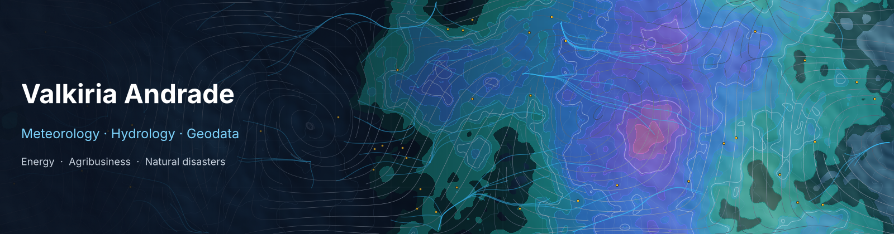

## Hi, I'm Valkiria 

Meteorologist (UFPA) and data analyst. I turn weather and climate data into decisions for **energy**, **agribusiness** and **natural-disaster risk**.

🇧🇷 *Meteorologista e analista de dados. Transformo dados de tempo e clima em decisões para energia, agronegócio e risco de desastres naturais.*

### ⚡ Energy
Senior Meteorology and Hydrology Analyst in the Brazilian power market. I build hydrometeorological scenarios for South America, prepare inputs for NEWAVE / DECOMP / DESSEM, automate ONS and CCEE data pipelines and verify forecasts against observations.

### 🌱 Agribusiness
Weather and climate forecasts and monitoring for agribusiness: rainfall and temperature outlooks, anomaly maps and seasonal forecasts to support planting, harvest and operations.

### 🌊 Natural disasters
Graduate studies in Natural Disasters at UNESP. I work with flood and drought signals, antecedent-wetness indices and early warning based on rainfall by river basin.

### Featured project
**[RS Corridor Flood Watch](https://github.com/valkiriaandrade/rs-corridor-flood-watch)**: early warning of flood potential on three federal highway corridors in Rio Grande do Sul. It combines satellite rainfall, official flood records and ECMWF/GFS forecasts, validated on 2013–2024 data (AUC 0.86). Daily runs, bilingual Streamlit dashboard and PDF briefing.
👉 [Live dashboard](https://rs-corridor-flood-watch.streamlit.app/?lang=en)

### Other projects
| Project | What it does |
|---|---|
| [MERGE-CPTEC](https://github.com/valkiriaandrade/MERGE-CPTEC) | Rainfall accumulation, climatology and anomaly maps for Brazil |
| [SAMET-CPTEC](https://github.com/valkiriaandrade/SAMET-CPTEC) | Monthly max/min temperature anomaly maps for Brazil |
| [NMME](https://github.com/valkiriaandrade/NMME) | Seasonal forecast maps from NMME / CFSv2 |
| [WRF](https://github.com/valkiriaandrade/WRF) | 2 m temperature maps from the WRF regional model |

Each one is a tested Python package with a command-line interface and CI.

### Data I work with
ECMWF · GFS · WRF · NMME/CFSv2 · MERGE · SAMeT · IMERG · ANA · S2iD · ONS · CCEE — in GRIB2, NetCDF, shapefiles and APIs.

### Tools

Also: Cartopy · ecCodes · ArcGIS Pro

### Contact

